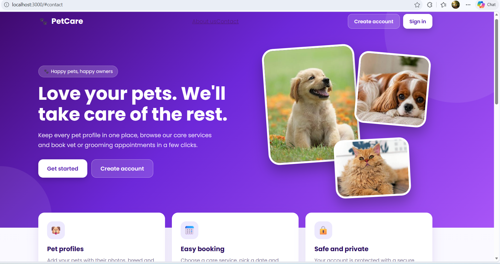
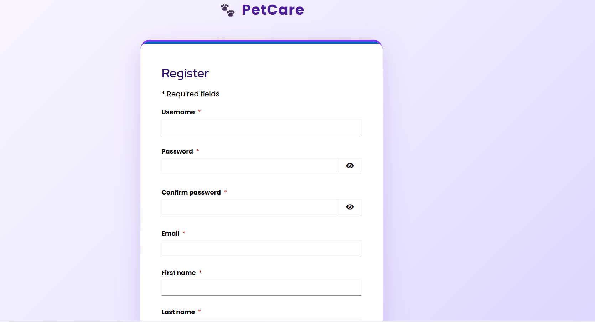
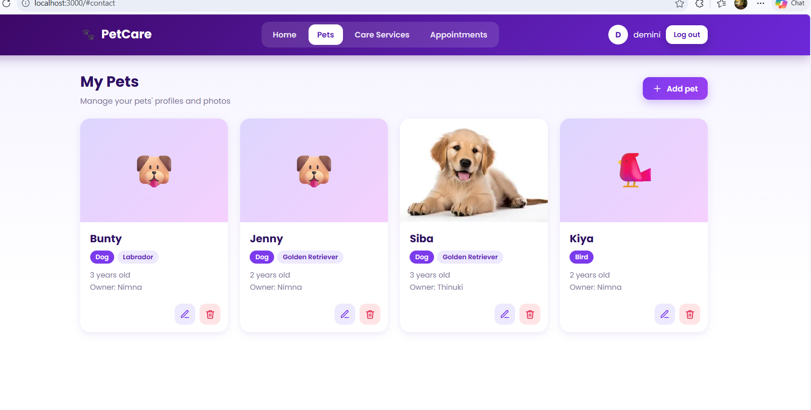
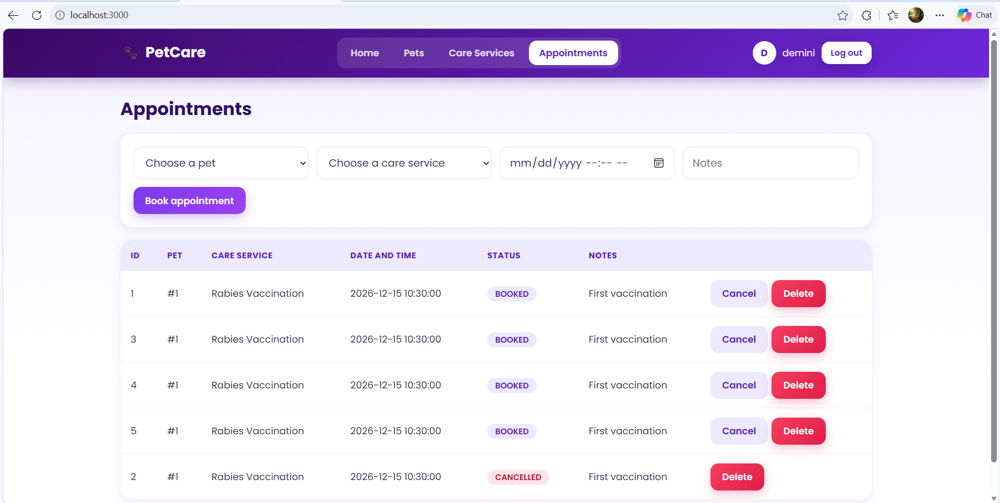
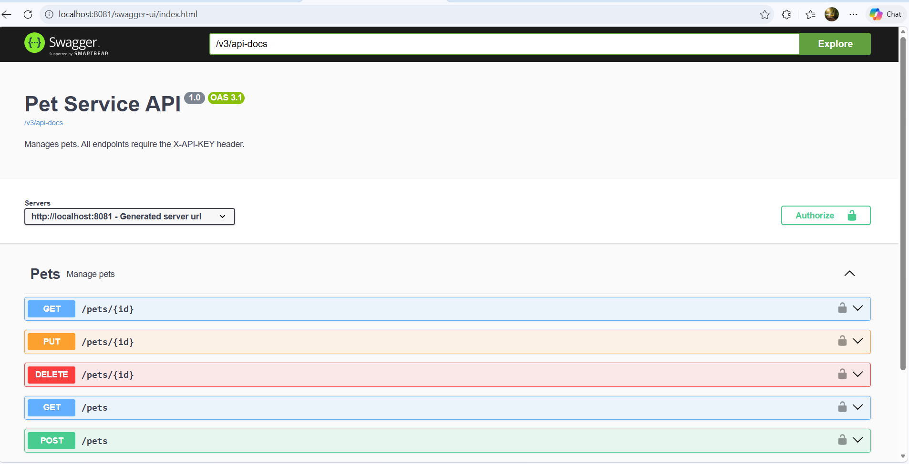
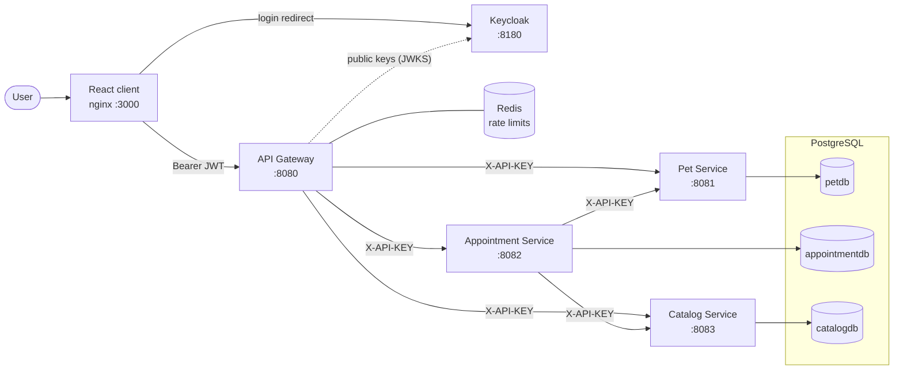
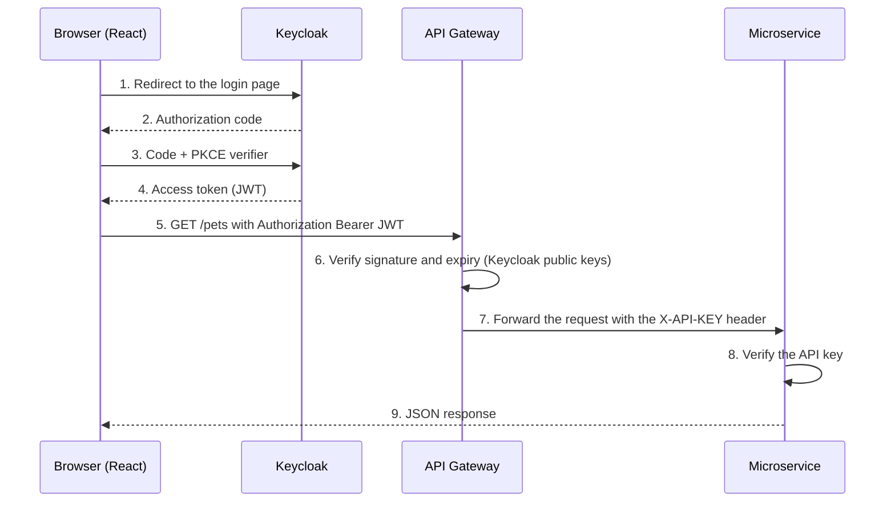

<div align="center">

# 🐾 PetCare

**A microservices pet-care platform: OAuth 2.0 login, an API gateway, rate limiting, and one-command Docker deployment.**




</div>

## Overview

PetCare lets pet owners **sign in, manage their pets (with photos), browse care services and book vet or grooming appointments**. Behind a simple web app sits a small but realistic microservices system:

- three independent **Spring Boot** services, each with **its own PostgreSQL database**
- one **API Gateway** that handles authentication, CORS and rate limiting
- **Keycloak** for OAuth 2.0 / OpenID Connect login
- a **React** single-page app
- **8 containers** started with a single command

Built as an individual project for the *Service Oriented Computing* module at Horizon Campus.

## Screenshots

| | |
|---|---|
|  |  |
|  |  |

## Highlights

- **Microservices** with clear boundaries: Pet, Catalog and Appointment services. The Appointment Service validates references by calling the other two over REST and returns `400` for unknown ids or `503` when a dependency is down.
- **Defense in depth:** the user is verified with an OAuth 2.0 JWT at the gateway, and every service also requires an **API key**, so calling a service directly is rejected.
- **API Gateway** (Spring Cloud Gateway) as the single entry point, with **CORS** rules and **Redis-backed rate limiting** (token bucket per client IP).
- **Secure browser login:** Authorization Code flow with **PKCE** through Keycloak, with a custom-themed login and registration page.
- **One-command deployment:** multi-stage Dockerfiles and Docker Compose with health checks and startup ordering.
- **Documented APIs:** Swagger UI (OpenAPI 3) on every service, plus a Postman collection.

## Architecture



### Request flow



## Tech stack

| Layer | Technology |
|---|---|
| Services | Java 21, Spring Boot 3.5, Spring Data JPA, Bean Validation |
| Gateway | Spring Cloud Gateway (WebFlux), Spring Security OAuth2 Resource Server |
| Authentication | Keycloak 26 (OAuth 2.0 / OIDC), JWT |
| Rate limiting | Redis 7 |
| Database | PostgreSQL 16 (one database per service) |
| API docs | springdoc-openapi (Swagger UI), Postman collection |
| Client | React, Vite, keycloak-js |
| DevOps | Docker, Docker Compose, nginx |

## Quick start

**Prerequisites:** Docker Desktop (allow about 6 GB of RAM) and these ports free: `3000, 5432, 6379, 8080-8083, 8180`.

```bash
git clone https://github.com/n-wijerathne/pet-care-system.git
cd pet-care-system
docker compose up -d --build
```

The first build takes 10 to 20 minutes while libraries download. After it starts, **wait 1 to 2 minutes** for Keycloak and the Java services, then open **http://localhost:3000** and sign in.

```bash
docker compose ps        # check all 8 containers
docker compose down      # stop (data is kept)
docker compose down -v   # stop and delete all data
```

### URLs

| What | URL |
|---|---|
| Web app | http://localhost:3000 |
| API Gateway | http://localhost:8080 |
| Pet Service Swagger UI | http://localhost:8081/swagger-ui.html |
| Appointment Service Swagger UI | http://localhost:8082/swagger-ui.html |
| Catalog Service Swagger UI | http://localhost:8083/swagger-ui.html |
| Keycloak admin console | http://localhost:8180 |

### Demo credentials

| Account | Username | Password |
|---|---|---|
| App user | `nimna` | `Pet@12345` |
| Keycloak admin | `admin` | `admin123` |
| PostgreSQL | `petcare` | `petcare123` |

You can also click **Create account** on the cover page (it asks for a contact number).

> These are demo values for running locally. Never reuse them anywhere real.

## API

All requests go through the gateway and need `Authorization: Bearer <access_token>`.

| Service | Endpoints |
|---|---|
| **Pet** | `GET /pets` · `POST /pets` · `GET /pets/{id}` · `PUT /pets/{id}` · `DELETE /pets/{id}` |
| **Catalog** | `GET /care-services` · `POST /care-services` · `GET /care-services/{id}` · `PUT /care-services/{id}` · `DELETE /care-services/{id}` |
| **Appointment** | `GET /appointments` · `POST /appointments` · `GET /appointments/{id}` · `PUT /appointments/{id}` · `PATCH /appointments/{id}/cancel` · `DELETE /appointments/{id}` |

Typical status codes: `200` / `201` / `204` success · `400` validation error or unknown reference · `401` missing or invalid token or API key · `404` not found · `429` rate limit exceeded · `503` a dependent service is down.

**Example: book an appointment**

```http
POST /appointments
Authorization: Bearer <access_token>
Content-Type: application/json

{ "petId": 1, "careServiceId": 1, "appointmentDateTime": "2026-12-20T09:00:00", "notes": "First vaccination" }
```

```json
{ "id": 6, "petId": 1, "careServiceId": 1, "appointmentDateTime": "2026-12-20T09:00:00", "status": "BOOKED", "notes": "First vaccination" }
```

### Get a token for Postman or curl

```bash
curl -s -X POST http://localhost:8180/realms/petcare/protocol/openid-connect/token \
  -d "grant_type=password" -d "client_id=petcare-client" \
  -d "username=nimna" -d "password=Pet@12345"
```

Use the `access_token` from the response. Tokens last 30 minutes. (The web app uses the more secure Authorization Code + PKCE flow. The password grant is only for quick testing.) A ready-made collection is in [`docs/postman`](docs/postman).

### Calling a service directly (API key)

Every service requires the header `X-API-KEY`. The gateway adds it for you. In Swagger UI, click **Authorize** and enter the key:

| Service | Header | Value |
|---|---|---|
| Pet Service | `X-API-KEY` | `pet-service-key-2026` |
| Catalog Service | `X-API-KEY` | `catalog-service-key-2026` |
| Appointment Service | `X-API-KEY` | `appointment-service-key-2026` |

## Security

| Mechanism | Where | Purpose |
|---|---|---|
| OAuth 2.0 / JWT | API Gateway | Proves **who the user is**. The gateway verifies the token signature and expiry with Keycloak's public keys |
| API key | Every microservice | Proves **the request came through the gateway**. Direct calls get `401` |
| CORS | API Gateway | Only `http://localhost:3000` may call the API from a browser |
| Rate limiting | API Gateway + Redis | Token bucket per client IP: 5 requests/second with a burst of 10. Extra requests get `429` |
| Non-root containers | Dockerfiles | Java services run as an unprivileged user |

**Try it yourself** (after getting a token as shown above):

```bash
curl -i http://localhost:8080/pets                                   # 401: no token
curl -i http://localhost:8081/pets                                   # 401: direct call, no API key
curl -i http://localhost:8080/pets -H "Authorization: Bearer <access_token>"   # 200
curl -i -X OPTIONS http://localhost:8080/pets -H "Origin: http://evil.com" -H "Access-Control-Request-Method: GET"   # 403: origin not allowed
```

## Design decisions

| Decision | Why |
|---|---|
| API Gateway as the only public entry point | One place for authentication, CORS and rate limiting, and the services stay hidden |
| JWT validation **and** per-service API keys | Two independent layers: the token identifies the user, the key stops anyone bypassing the gateway |
| Database per service | Each service owns its schema and can change or scale on its own |
| Rate limits in Redis | Counters are shared and fast, so limits stay correct even with several gateway instances |
| Keycloak instead of custom auth | Proven OAuth 2.0 / OIDC implementation. A realm file is imported on startup, so the setup is reproducible |
| Authorization Code + PKCE in the browser | The password is only ever typed on Keycloak's page, and the code flow is safe for single-page apps |
| Settings as environment variables | The same images run locally and in Docker. Only the configuration changes |
| Pet photos as resized data URLs | Keeps the demo self-contained, with no extra storage service |

## Project structure

```
pet-care-system/
├── api-gateway/            Spring Cloud Gateway: routing, OAuth2, CORS, rate limiting
├── pet-service/            Pets and photos
├── catalog-service/        Care services and prices
├── appointment-service/    Booking (calls the Pet and Catalog services)
├── client/                 React app (Vite), served by nginx in Docker
├── keycloak/               Realm import file and the login page theme
├── db/                     init.sql (creates the three databases)
├── docs/                   Screenshots and the Postman collection
└── docker-compose.yml      Starts the whole system
```

## Local development

```bash
docker compose up -d postgres keycloak redis      # infrastructure only
cd pet-service && mvn spring-boot:run             # same for the other services and the gateway
cd client && npm install && npm run dev           # http://localhost:3000
```

Stop the containerised services and client first so the ports are free.

## Troubleshooting

| Problem | Fix |
|---|---|
| "Cannot reach the login server" right after start | Keycloak is still starting. Wait 1 to 2 minutes and refresh |
| Everything returns `401` after restarting Keycloak | Run `docker compose restart api-gateway` |
| `port is already allocated` | Another program uses that port. Stop it and run `docker compose up -d` again |
| A container exits with code `137` | Out of memory. Give Docker Desktop 6 GB or more |
| `Too many requests` | The rate limit. Wait a few seconds |

## Known limitations and roadmap

- [ ] Link pets to the logged-in user (store the token's `sub` as the owner and filter by it)
- [ ] Enforce the `user` / `admin` roles with role-based authorization
- [ ] Add automated tests (unit and integration) and run them in CI
- [ ] Add a circuit breaker and retries for service-to-service calls
- [ ] Store photos in object storage (S3 or MinIO) instead of the database
- [ ] Run Keycloak in production mode with HTTPS and a real database, and move secrets to a vault
- [ ] Centralised logging and metrics

## Author

**Nimna Wijerathne** · Horizon Campus · [GitHub](https://github.com/n-wijerathne) 